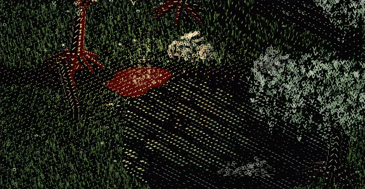
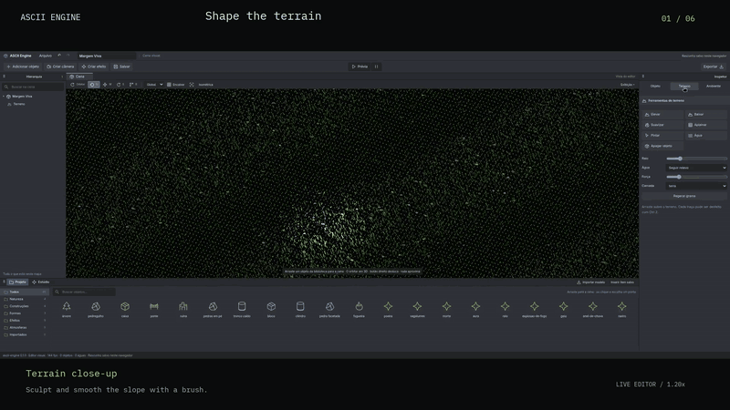
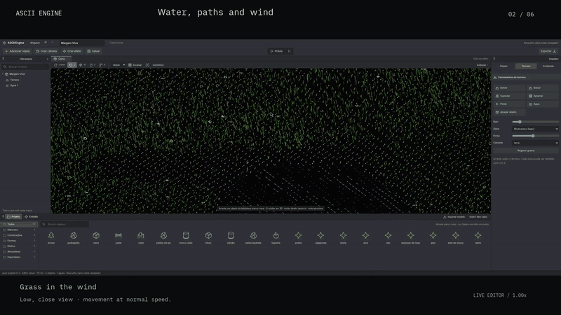
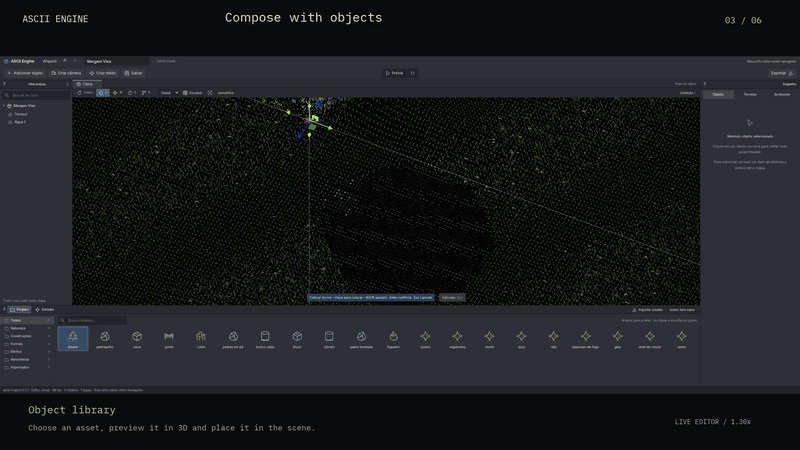
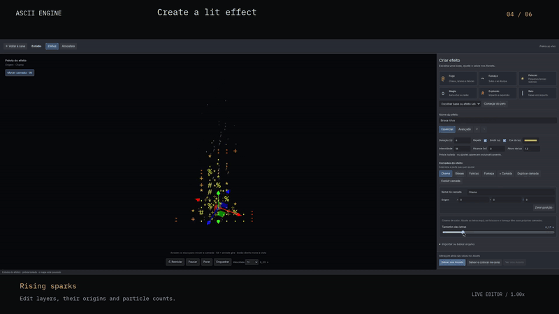
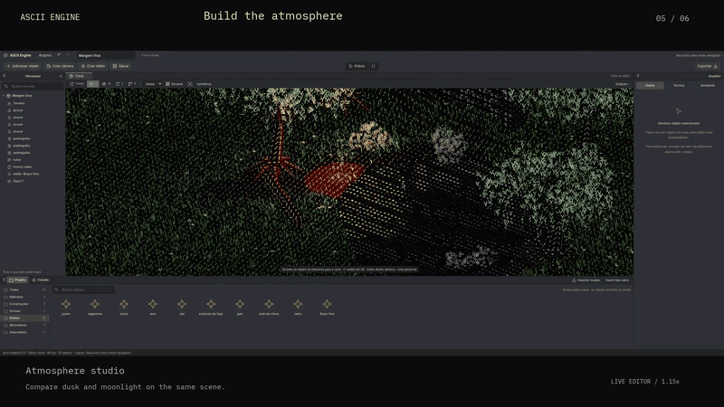
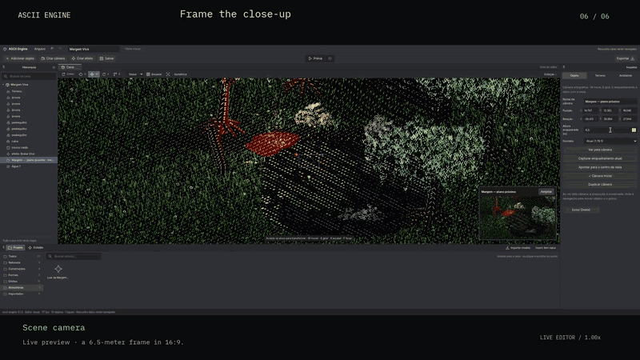

# ASCII Engine

**Build 3D worlds made of letters.**

ASCII Engine is a visual engine and editor for creating ASCII 3D scenes.
Sculpt terrain, paint water, arrange objects and bring your world to life
with wind, particles, lighting and atmosphere. Letters follow the geometry
and movement of the things they form.



## See it in action

These animated previews show what you can create with the editor, from
shaping a map to framing the finished scene. GIFs play directly in this
README. [Watch the full chapters with video players](https://joaovrmoraes.github.io/ascii-engine/watch.html),
or download them below. The [local gallery](docs/showcase/index.html)
also works from a checkout.
The existing footage is re-edited with English captions; its captured
historical interface is Portuguese. The current editor uses English.

### 01 · Terrain

Create a map, sculpt its elevation and smooth slopes with brushes. Terrain
and grass coverage follow the shape you build.

[](https://joaovrmoraes.github.io/ascii-engine/watch.html#01-terrain)

[Download the full video](docs/showcase/videos/01-terrain.mp4?raw=true)

### 02 · Water, paths and wind

Paint a lake, shape its shoreline and clear a path through the grass.
Move the camera closer to see individual glyphs sway in the wind. Water
and reflections are drawn in letters too.

[](https://joaovrmoraes.github.io/ascii-engine/watch.html#02-water-paths-and-wind)

[Download the full video](docs/showcase/videos/02-water.mp4?raw=true)

### 03 · Objects and composition

Choose trees, rocks, ruins and logs from the asset library. Preview objects
in the scene before placing them, then adjust their position, rotation
and scale with the inspector or transform gizmos.

[](https://joaovrmoraes.github.io/ascii-engine/watch.html#03-objects-and-composition)

[Download the full video](docs/showcase/videos/03-objects.mp4?raw=true)

### 04 · Effects and lighting

Build a fire in the effect studio. Adjust its layers, sparks and light,
save the effect to the asset library and place it in the scene to illuminate
the surrounding objects and grass.

[](https://joaovrmoraes.github.io/ascii-engine/watch.html#04-effects-and-lighting)

[Download the full video](docs/showcase/videos/04-effects.mp4?raw=true)

### 05 · Atmosphere

Explore dusk and moonlight on the same scene. Adjust exposure, color,
light direction, shadows and fog, then save an atmosphere to reuse
in other compositions.

[](https://joaovrmoraes.github.io/ascii-engine/watch.html#05-atmosphere)

[Download the full video](docs/showcase/videos/05-atmosphere.mp4?raw=true)

### 06 · Cameras, preview and export

Observe animated water, place a camera with a live thumbnail and choose
the initial framing. Save the editable map, export its scene document
and preview the composition with animated grass, water and fire.

[](https://joaovrmoraes.github.io/ascii-engine/watch.html#06-cameras-preview-and-export)

[Download the full video](docs/showcase/videos/06-camera.mp4?raw=true)

## What you can create

- **Maps and items:** brush-based terrain, paths, water, built-in assets
  and imported GLTF/GLB models.
- **Per-part styles:** give a tree's crown and trunk, or individual parts
  of a model, their own glyph technique, alphabet, size and color.
- **Reusable effects:** particle layers, fire, smoke, sparks and lights,
  with an isolated preview and recipes saved to the library.
- **Environments:** lighting, shadows, fog, rain and snow.
- **Compositions:** saved orthographic cameras, aspect ratios,
  live thumbnails and preview through the initial camera.
- **Editable scenes:** undo/redo, a local draft, saving, reopening
  and JSON export.

The project grew out of **Pomorog's** visual style. Its demos include
Dark Forest, Rain Marsh, Snow Pines, Old Mine and Sunken Cathedral,
along with animated characters and scripted combat encounters.

## Try it

Requires Node.js and pnpm. The workspace uses pnpm **11.9.0**.

```bash
pnpm install
pnpm dev
```

Open [localhost:1440](http://localhost:1440) to create a scene.
[Dark Forest](http://localhost:1440/?area=dark_forest) shows the character,
creature and combat effect demo.

In the editor, **W** moves, **E** rotates, **R** scales and **O** activates
orbit. Drag assets from the library into the scene. Open **Studio** for
effects and atmospheres, and **Preview** to view the animated composition.

Export a web demo without the editor panels:

```bash
pnpm export -- --title "Dark Forest" --area dark_forest
```

The output is `exports/dark-forest/web/` and can be served over HTTP.
Saved scenes can also be exported with `--scene path/to/scene.ascii.json`.

## Project status

In development. The current release covers visual content creation,
editing and export. The player runs scenes and existing demos. Gameplay
components and scripts attached to objects through the editor are a future
stage; demo combat follows a programmed sequence.

## Development

The core in `packages/engine` uses TypeScript and Three.js, with glyph
techniques declared per object and per part. The editor in `apps/editor`
uses Vite and includes a Tauri desktop shell. Data authoring and the
API/MCP automation bridge live in separate modules.

```bash
pnpm check              # types, tests and build
pnpm compare            # visual demo comparison; requires pnpm dev
pnpm verify:authoring   # editor interaction checks; requires pnpm dev
```

## Documentation

- [Visual editor guide](docs/guia-editor-visual.md): tools and creation workflow.
- [Example scenes](docs/examples/): documents to open in the editor.
- [Authoring API and MCP](docs/api-mcp.md): tools and agent integration.
- [Architecture and plan](START.md): principles, systems and milestones.
- [Development log](docs/log.md): changes and validation.
- [Visual origin: Pomorog](reference/pomorog/README.md): read-only reference.
- [Agent instructions](AGENTS.md).
