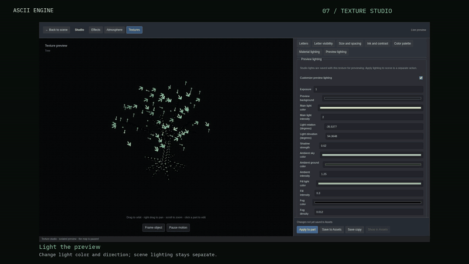
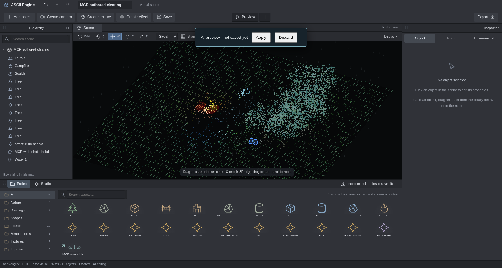

# ASCII Engine

**Build 3D worlds made of letters.**

ASCII Engine is a visual engine and editor for creating ASCII 3D scenes.
Sculpt terrain, paint water, arrange objects and bring your world to life
with wind, particles, lighting and atmosphere. Letters follow the geometry
and movement of the things they form.

## Try in your browser

Use the map buttons in the [live gallery](https://joaovrmoraes.github.io/ascii-engine/#try-in-your-browser)
to switch between five demos inside the page. No installation is needed.

- [Dark Forest](https://joaovrmoraes.github.io/ascii-engine/sandbox/?area=dark_forest): explore the forest, animated characters and combat effects.
- [Rain Marsh](https://joaovrmoraes.github.io/ascii-engine/sandbox/?area=rain_marsh): explore rain, wetlands and water ripples.
- [Snow Pines](https://joaovrmoraes.github.io/ascii-engine/sandbox/?area=snow_pines): explore snowy branches, falling snow and tracks.
- [Old Mine](https://joaovrmoraes.github.io/ascii-engine/sandbox/?area=old_mine): explore tunnels and lantern lighting.
- [Sunken Cathedral](https://joaovrmoraes.github.io/ascii-engine/sandbox/?area=sunken_cathedral): explore ruins, reflected water and interior lighting.

Drag to rotate the demo camera, scroll to zoom and use the controls to adjust
letters and light or pause the animation. The demo menu contains these five
maps for viewing. To create scenes or work with AI/MCP, use the local editor
setup described below.


## See it in action

These animated previews show what you can create with the editor, from
shaping a map to framing the finished scene. GIFs play directly in this
README. [Watch the full chapters with video players](https://joaovrmoraes.github.io/ascii-engine/watch.html),
or download them below. The [local gallery](docs/showcase/index.html)
also works from a checkout.
Chapters 01–06 reuse existing footage with English captions; their captured
historical interface is Portuguese. Texture Studio shows the current
English editor.

### 01 · Terrain

Create a map, sculpt its elevation and smooth slopes with brushes. Terrain
and grass coverage follow the shape you build.

[](https://joaovrmoraes.github.io/ascii-engine/watch.html#01-terrain)

[Download the full video](docs/showcase/videos/01-terrain.mp4?raw=true)

### 02 · Water, paths and wind

Paint a lake, shape its shoreline and clear a path through the grass.
Move the camera closer to see individual glyphs sway in the wind. Water
and reflections are drawn in letters too.

[](https://joaovrmoraes.github.io/ascii-engine/watch.html#02-water-paths-and-wind)

[Download the full video](docs/showcase/videos/02-water.mp4?raw=true)

### 03 · Objects and composition

Choose trees, rocks, ruins and logs from the asset library. Preview objects
in the scene before placing them, then adjust their position, rotation
and scale with the inspector or transform gizmos.

[](https://joaovrmoraes.github.io/ascii-engine/watch.html#03-objects-and-composition)

[Download the full video](docs/showcase/videos/03-objects.mp4?raw=true)

### 04 · Effects and lighting

Build a fire in the effect studio. Adjust its layers, sparks and light,
save the effect to the asset library and place it in the scene to illuminate
the surrounding objects and grass.

[](https://joaovrmoraes.github.io/ascii-engine/watch.html#04-effects-and-lighting)

[Download the full video](docs/showcase/videos/04-effects.mp4?raw=true)

### 05 · Atmosphere

Explore dusk and moonlight on the same scene. Adjust exposure, color,
light direction, shadows and fog, then save an atmosphere to reuse
in other compositions.

[](https://joaovrmoraes.github.io/ascii-engine/watch.html#05-atmosphere)

[Download the full video](docs/showcase/videos/05-atmosphere.mp4?raw=true)

### 06 · Cameras, preview and export

Observe animated water, place a camera with a live thumbnail and choose
the initial framing. Save the editable map, export its scene document
and preview the composition with animated grass, water and fire.

[](https://joaovrmoraes.github.io/ascii-engine/watch.html#06-cameras-preview-and-export)

[Download the full video](docs/showcase/videos/06-camera.mp4?raw=true)

### 07 · Texture Studio

Select an object or named part and shape its appearance in an isolated
preview. Choose letters and fonts, adjust size, spacing, colors and contrast,
or show only the letters. Tune the preview lights, then apply and save
the texture to reuse on another object.

[](https://joaovrmoraes.github.io/ascii-engine/watch.html#07-texture-studio)

[Download the full video](https://github.com/joaovrmoraes/ascii-engine/releases/download/v0.1.0/07-textures.mp4)

## Create with AI through MCP

An AI agent can run the complete supported visual authoring workflow through
the local MCP server: create a scene, inspect its rendered result, adjust it
and export an editable document. Once the editor and client are connected,
the agent can perform these operations without manual interface clicks.

- Sculpt terrain, paint water, arrange objects and import GLTF/GLB models.
- Edit named model parts; create and reuse textures, effects and atmospheres.
- Adjust letters, fonts, colors, lighting, fog, weather and composition cameras.
- Read the live catalog, preview edits, inspect PNG captures and undo/redo.
- Save and reopen portable scenes with embedded models and reusable assets.
- Queue Web/Tauri project exports and read their build status through MCP.

**Example prompt:** “Create a moonlit clearing with a lake and trees. Give
the tree crowns green arrow glyphs with no solid body, save that texture,
show me a preview and export the editable scene.”



The server exposes 16 tools. `scene_apply` accepts atomic batches;
`scene.patch` and `scene.replace` cover every supported `SceneDoc` field.
Each accepted batch shares the editor's undo history. This covers the visual
features currently implemented; gameplay rules and unsupported rendering
features require additional development. MCP runs locally and needs an open
editor session and an MCP-capable AI client.

Start the editor with `pnpm dev`, then configure your client using the
[MCP configuration example](https://github.com/joaovrmoraes/ascii-engine/blob/main/.mcp.example.json),
replacing the example paths with your checkout. Follow the
[connection guide and tool reference](docs/api-mcp.md) for setup and commands.

## What you can create

- **Maps and items:** brush-based terrain, paths, water, built-in assets
  and imported GLTF/GLB models.
- **Per-part styles:** give a tree's crown and trunk, or individual parts
  of a model, their own glyph technique, alphabet, size and color.
- **Reusable effects:** particle layers, fire, smoke, sparks and lights,
  with an isolated preview and recipes saved to the library.
- **Reusable textures:** letters, fonts, visibility, palettes and preview
  lights, applied to whole objects or named parts and saved to the library.
- **Environments:** lighting, shadows, fog, rain and snow.
- **Compositions:** saved orthographic cameras, aspect ratios,
  live thumbnails and preview through the initial camera.
- **Editable scenes:** undo/redo, a local draft, saving, reopening
  and JSON export.

The project grew out of **Pomorog's** visual style. Its demos include
Dark Forest, Rain Marsh, Snow Pines, Old Mine and Sunken Cathedral,
along with animated characters and scripted combat encounters.

## Try it

Requires Node.js and pnpm. The workspace uses pnpm **11.9.0**.

```bash
pnpm install
pnpm dev
```

Open [localhost:1440](http://localhost:1440) to create a scene.
[Dark Forest](http://localhost:1440/?area=dark_forest) shows the character,
creature and combat effect demo.

In the editor, **W** moves, **E** rotates, **R** scales and **O** activates
orbit. Drag assets from the library into the scene. Open **Studio** for
effects, atmospheres and textures, and **Preview** to view the animated
composition.

Export a web demo without the editor panels:

```bash
pnpm export -- --title "Dark Forest" --area dark_forest
```

The output is `exports/dark-forest/web/` and can be served over HTTP.
Saved scenes can also be exported with `--scene path/to/scene.ascii.json`.

## Performance

The [performance study](docs/performance.md) includes capacity tables and nine
reproducible charts for this i5-12450H / Chromium headless / ANGLE GL profile.
Optimized JavaScript makes the reference skinning step 45× faster and frame p50
52% lower. Hidden water pauses in the editor and exported player; offline/parity
views simulate everything. No WebAssembly is used; the remaining visible-water
numeric step is [under owner review](docs/decisions/0004-webassembly-for-simulation.md).

## Project status

In development. The current release covers visual content creation,
editing and export. The player runs scenes and existing demos. Gameplay
components and scripts attached to objects through the editor are a future
stage; demo combat follows a programmed sequence.

## Development

The core in `packages/engine` uses TypeScript and Three.js, with glyph
techniques declared per object and per part. The editor in `apps/editor`
uses Vite and includes a Tauri desktop shell. Data authoring and the
API/MCP automation bridge live in separate modules.

The renderer accepts appearance and effect libraries explicitly. Import
specialized APIs through `@ascii-engine/core/techniques`, `/world` or `/fx`;
optional Pomorog recipes use `/pomorog`. See the
[package boundary decision](docs/decisions/0003-package-boundaries.md).

```bash
pnpm check              # types, tests and build
pnpm compare            # visual demo comparison; requires pnpm dev
pnpm verify:authoring   # editor interaction checks; requires pnpm dev
```

## Documentation

- [Visual editor guide](docs/guia-editor-visual.md): tools and creation workflow.
- [Example scenes](docs/examples/): documents to open in the editor.
- [Authoring API and MCP](docs/api-mcp.md): tools and agent integration.
- [Architecture and plan](START.md): principles, systems and milestones.
- [Development log](docs/log.md): changes and validation.
- [Visual origin: Pomorog](reference/pomorog/README.md): read-only reference.
- [Agent instructions](AGENTS.md).
