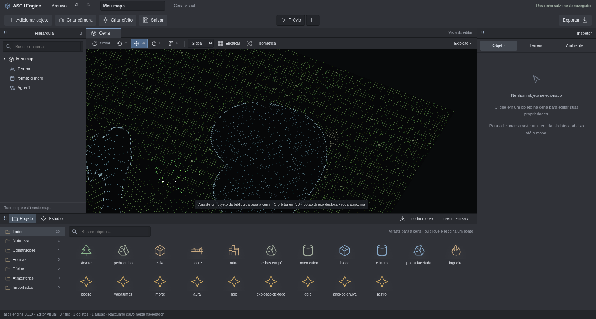

# 3D camera, preview and water — 2026-10-11

Real GPU Chromium/Orca Browser captures; no generated images. A copy of the
owner's scene was used only in an isolated profile to reproduce the reported
views. The owner's tab document was not replaced.

## Camera

- [Live thumbnail during gizmo movement](camera-miniatura.png).
- [Selected camera and lake, cdpshot](camera-cdpshot.png).
- verify-composition.log: native drags, horizontal/vertical orbit, live
  thumbnail, initial-camera preview, history, effects and player.
- Also suspends requestAnimationFrame and checks that the visible page
  animates/updates its camera through the fallback.
- [Orca Browser](orca-agua.png): previously no rAF despite document.hidden
  being false. After the fix, time advances at 20 fps.

## Water

| Before | After |
| --- | --- |
|  |  |

- [Side reflection of cylinder](cilindro-reflexo-lateral.png),
  [reflection disabled](cilindro-sem-reflexo.png),
  [opposite shore](cilindro-vista-oposta.png).
- [Camera-aligned moonlight](luar-alinhado.png) and
  [rotated light](luar-rotacionado.png).
- [Before impact](agua-antes-impacto.png),
  [moving-object trail](agua-rastro-do-objeto.png).
- [Initial slope](encosta-inicio.png), [flow](encosta-escoando.png),
  [inspector](inspetor-agua.png).
- [Cathedral channels](catedral-agua.png): GLSL shape and CPU simulation
  domain match, preserving the existing water region.

verify-water.log checks canvas changes >8/255, view-dependent reflection,
light-dependent highlights, object-driven surface movement, downhill flow,
wet vertices above terrain and simulation-independent recipe data. Core tests
cover volume conservation, elevation stability, sources and waves staying
inside shores.

## Validation and limits

pnpm check: 77 tests, types and build passed. This folder contains water,
composition, visual, authoring and API logs. cdpshot.log reports 60 fps with
thumbnail. Existing bundle/Zod PURE warnings remain. Five compare views
passed; forest exceeded the limit at RMSE 0.0595. Isolated rerun passed at
0.0095 with unchanged code/baseline. Forest has recorded time-integration
variation based on frame intervals.

Shallow heightfield water stays within the painted mask. Falls follow terrain;
no volumetric fluid, expansion beyond paint, ballistic splashes, free curtain
or rigid buoyancy. Highlights come from the main light, without a new moon
sky disc. Objects mirror on calm regions; separate particles are excluded.
Native Tauri was not executed; cameras remain orthographic. Images retain
historical Portuguese UI.
