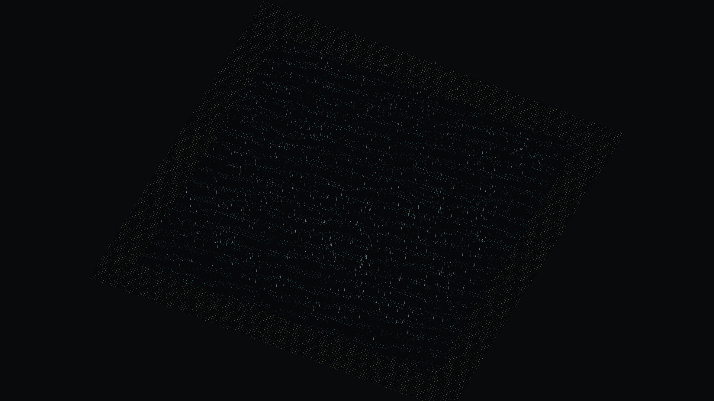
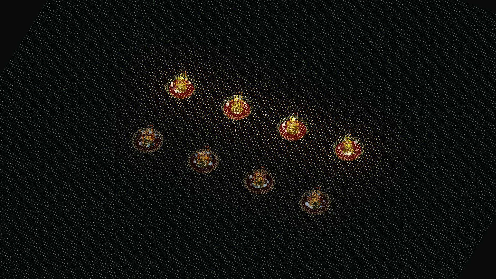
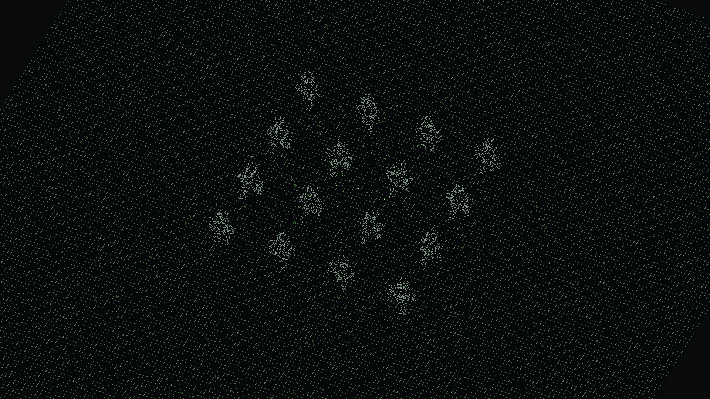

# Phase 1 provenance and validation

The [generated report](README.md) contains the complete per-scene CPU p50/p95,
frame shares and qualification table. [summary.json](summary.json) also retains
p99 and round differences. ADR 0004 remains **Proposed**. Only Phase 1 was executed.

## Reproduction and source

The owner confirmed the decision rule before measurements. The original plan was
committed byte for byte as d48998a; the Proposed decision rule was committed as
b5640e0 before collecting numbers. The final benchmark source is
`d105af5e7962f2d2507a0a0aabb7f069d024a836`, with a clean tracked tree at both starts.
No optimized JS baseline, alternate GPU/WASM implementation or Rust toolchain was
created or installed. The owner's editor consolidation plan was left untouched.

With `pnpm dev` serving port 1440, run the following serially, with no other GPU
tests, captures or source edits during collection:

```sh
pnpm bench --round=round-1
pnpm bench --round=round-2
pnpm bench:report
```

Use `--out=<new-directory>` to preserve existing data; the runner refuses to
overwrite an existing round. Defaults are 600 warm-up steps followed by 600
measured steps, five fresh scene loads per scene per round, with scene order
water, particles, skinning repeated five times. That is 18,000 measured frames
plus 18,000 discarded warm-up frames across the two final rounds. Every step is
1/60 s. Viewport is 1920×1080 CSS pixels at DPR 1. Each scene reaches simulation
time 20 s; final state hashes agree in all ten loads of each scene.

The dev-only `/?bench=water`, `/?bench=particles` and `/?bench=skinning` entries
do not import the sandbox, its document or persistence modules. The runner
injects guards for IndexedDB open/delete/list operations and checks that none
were attempted. Separate temporary Chromium profiles are removed on exit;
the owner's editor draft is never used.

## Fixtures and environment

All scenes have a 34 m floor, 1,800 carpet instances, general/effect seed 4242,
carpet seed 48017, focus [0, 0.6, 0], camera angle π/7 and elevation atan2(18, 15).
Orthographic span is 17 for water and 9 for the other two scenes.

| Scene | Fixed workload |
| --- | --- |
| water | 28 m painted, fully wet 129×129 lake; simulated depth/flow, rain rings, 1,000 rain streaks and planar reflection |
| particles | Eight campfires and sixteen continuously looping fire/ice combat effects; 6,000 particle budget |
| skinning | Sixteen actual SkinnedMesh humanoids, seven bones each, six merged box parts, 0.9/0.1 weights and deterministic limb animation; 18,179 skinned letter points |

The full environment is recorded separately in [round 1](round-1/environment.json)
and [round 2](round-2/environment.json): Intel i5-12450H, 12 logical CPUs, Intel
ADL GT2 through Mesa/ANGLE OpenGL ES, Omarchy 4.0.4, Linux 7.2.3-arch1-3,
Chromium 152.0.7977.82. The sampled power profile and EPP were `performance`;
the `intel_pstate` governor reported `powersave`. No system power setting was
changed. Per-run frequency snapshots are retained; they are not a time series
of the core executing JavaScript. Launch flags reuse the GPU/GL settings from
the existing cdpshot helper, with an isolated profile and explicit DPR 1.

Benchmark documents alone enable cross-origin isolation for approximately
0.005 ms clock resolution. A displayed 0.000 ms section can be absent or below
that resolution; it does not establish zero cost.

## Clocks, stability and interpretation

Final `frameMs` uses actual callback entry intervals from `performance.now()`;
`rafIntervalMs` separately retains the browser's scheduled rAF cadence. Active
CPU frame work includes scene animation, camera setup and render submission.
GPU elapsed ranges are asynchronous and tagged to the original render frame.
CPU/GPU overlap; adding their medians is invalid. Water upload is CPU texture,
geometry, normal and bounds preparation/submission, not GPU transfer completion.

An independent [180-frame diagnostic](clock-diagnostic.json) found that native
rAF timestamps obscured dispatch jitter: p95 cadence was 16.670 ms while actual
callback p95 was 16.890 ms. The first two rounds that used cadence alone are
preserved under [preliminary-raf](preliminary-raf/README.md), explicitly excluded
from final qualification. The clock correction and ADR method clarification
were committed before the two final rounds. No threshold or simulation changed.

Full-frame p50 round differences are 0.00% water, 0.03% particles and 0.00%
skinning, within the predeclared 5% frame gate. The material candidate sections
also repeat: water step 1.50%, combined water preparation 2.50%, effects 1.96%
and skinned vertex math 0.36%. Remaining render submission is less stable:
5.65%, 11.43% and 8.70% respectively, representing differences of only 0.025,
0.040 and 0.065 ms. That residual includes scene-graph preparation, renderer/
driver submission, query polling and instrumentation overhead. Frequency varies
between snapshots; these data do not isolate the cause of residual variation.
No speedup conclusion is drawn for that aggregate. Tiny sections also approach
clock resolution. Per-run summaries and every sample remain available.

Only skinning passes both the 15% frame-share and numeric-array criteria:
14.015 ms p50, 16.935 ms p95, 84.12% of the median frame. GPU skinning is the
appropriate later comparison to consider. Water step is 6.00%; effects 3.06%.
Combined water preparation is 17.97%, but mixes array work with Three.js geometry
updates and does not establish a portable numeric kernel by itself.

All scenes are paced near 60 Hz at p50. Reducing CPU work does not automatically
reduce this paced full-frame median. No 2× isolated-step gain, 15% full-frame
gain or cross-implementation parity has been demonstrated. The adoption rule
and JS fallback requirement remain unchanged and untested. Stop before Phase 2.

## Validation and captures

- `pnpm check`: final formatting, boundaries, type checks, 164 tests and editor
  production build; see [check.log](validation/check.log).
- Final clean-source smoke: `pnpm bench --verify --out=.cache/bench-study/accepted`.
  All three scenes have exact profiling on/off state fingerprints, byte-identical
  PNGs, zero IndexedDB calls and real skinned points. See
  [run log](validation/verify-benchmark.log),
  [state parity](validation/benchmark-parity.json) and
  [image hashes](validation/image-parity.json).
- [Dataset audit](validation/dataset-audit.json): 18,000 measured frames, complete
  asynchronous GPU samples, zero disjoint events/dropped queries/visibility
  changes, consistent section accounting and identical final state per scene.
- `pnpm compare` was run before and after the renderer instrumentation. Both
  return exit 1 for the same four existing historical baselines. No baseline
  was regenerated. See [before](validation/compare-before.log) and
  [after](validation/compare-after.log), and the table below.
- A controlled before/after comparison against core b5640e0 gives **RMSE 0**
  in reference and all five existing areas. Both sides use the same injected
  1/60 rAF clock, `pause=3&peaceful=1`, 1600×900 viewport and hidden HUD. The
  ordinary editor's 50 ms fallback timer is disabled in both test pages only.
  A separate Vite server aliases the old core from a Git archive. The ordinary
  application's clock and defaults are unchanged. See
  [all six results](validation/legacy-parity.json), with representative
  [reference before](validation/reference-before.png)/
  [after](validation/reference-after.png) and
  [marsh before](validation/rain_marsh-before.png)/
  [after](validation/rain_marsh-after.png). The temporary server was stopped.
- Orca used explicit editor page `4d61c29e-ae0f-4880-a018-3d0e6313dbfe` in a
  separate browser profile. Navigation to `http://localhost:1440/?bench=water`
  succeeded, but subsequent read/evaluation/capture commands timed out with
  `runtime_unavailable`. The owner confirmed visually: “Sim, o lago aparece”.
  That confirms the lake is visible in Orca; automated inspection/capture there
  remains unavailable. All saved images below are page-only CDP captures from
  isolated GPU Chromium, with no desktop or personal application content.

| Historical baseline | Before RMSE | After RMSE | Limit | Result both times |
| --- | ---: | ---: | ---: | --- |
| Reference | 0.0410 | 0.0410 | 0.04 | Fail |
| Dark Forest | 0.0697 | 0.0405 | 0.04 | Fail |
| Rain Marsh | 0.1138 | 0.1137 | 0.20 | Pass |
| Snow Pines | 0.0437 | 0.0440 | 0.04 | Fail |
| Old Mine | 0.0341 | 0.0352 | 0.04 | Pass |
| Sunken Cathedral | 0.0494 | 0.0490 | 0.04 | Fail |

Benchmark smoke captures, taken at simulation time 4 s after 60 warm-up and
180 measured steps (these smoke samples are not part of the performance report):







## Raw format

Each `<round>/<scene>.json` stores `columns` and compact per-run `samples` rows,
plus per-run metadata/percentiles and a round summary. Zip each sample with
`columns` to recover named values. All durations are milliseconds. `gpuMs` is
nullable when unsupported/unavailable; zeros remain valid CPU observations.
`before`/`after` snapshots contain wall dates and CPU frequency. The environment
file identifies the exact source commit and launch conditions. The generated
summary pools equal-sized runs from the two final rounds using nearest-rank
percentiles; independent subsystem medians need not sum to the frame median.
