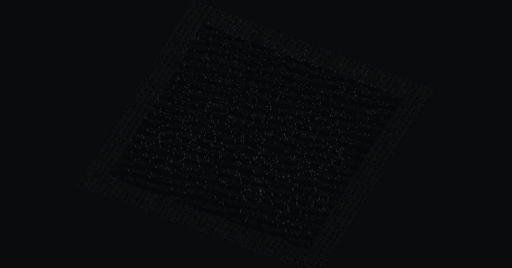

# Phase 1 amendment — uncapped method and validation

The owner requested an uncapped measurement before Phase 2. The original
[plan](../../wasm-performance-study-plan.md) remains unchanged; ADR 0004 stays
**Proposed**. The [current report](README.md) contains the uncapped results.
The original [paced report](vsync-report.md), [paced summary](vsync-summary.json),
round-1/round-2 raw files and original study notes are retained unchanged as
historical evidence. Their 16.665 ms median measures display cadence; its frame
shares and repeatability do not establish uncapped workload cost.

## Method fixed before the accepted rounds

Runtime source: af0413f, after 99e1bf0 introduced uncapped browser flags and
bottleneck-aware qualification and d48ffbb bounded in-flight GPU work. No renderer, simulation kernel, scene fixture,
letter count, seed, camera or document format changed. Ordinary editor clocks
and capture flags remain unchanged. This work does not optimize the JavaScript
or implement an alternative GPU/WASM path.

```sh
pnpm dev
pnpm bench --uncapped --round=uncapped-round-1
pnpm bench --uncapped --round=uncapped-round-2
pnpm bench:report
```

Each scene uses five fresh loads per round, 600 warm-up and 600 measured frames,
at 1920×1080 CSS pixels, DPR 1 and fixed simulation dt 1/60 s. Water is the same
129×129 simulated lake with rain/reflection; particles the same eight campfires
and sixteen looping combat effects; skinning the same sixteen seven-bone meshes
and 18,179 skinned glyph points. Every scene reaches simulation time 20 s.
Temporary browser profiles and injected IndexedDB guards isolate the editor's
saved draft. No owner draft is read or modified by the harness.

Chromium adds --disable-gpu-vsync and --disable-frame-rate-limit. Removing the
flags alone is insufficient to interpret callback rate as completed throughput:
the [partial submission diagnostic](submission-diagnostic/README.md) observed
particles callbacks near 0.6 ms while GPU ranges took about 11 ms, with many timer
queries dropped when the CPU ran ahead. That collection was stopped and retained;
it is not qualification evidence.

The accepted harness uses opt-in queue=2 and a free-running MessageChannel task
loop instead of requestAnimationFrame. Asynchronous WebGL fences bound the GPU
queue to two frames. CPU frame N can overlap GPU frame N-1; gl.flush submits
commands, and clientWaitSync with zero timeout only polls. There is no gl.finish
or blocking per-frame wait. Non-nested 1 ms timers poll outside rAF, avoiding a
spin loop or coupling render steps to compositor callback cadence. All GPU work drains at
run end. A supported GPU timer must return every measured sample without dropped
queries or disjoint events, otherwise the runner rejects the round.

A complete [rAF-bounded experiment](raf-bounded-diagnostic/README.md) also remains:
water submission p50 varied 6.40% while CPU/GPU p50 varied 1.05%/0.38% and
completion p50 1.08%. Its alternating short/long submissions changed the median
more than actual work or sustained throughput. The failure was not hidden or
called a pass. The final task scheduler was committed before two fresh rounds
with the same run counts, 5% repeatability gate and decision thresholds.

## What the clocks mean

- frameMs: actual performance.now interval between simulation/render submissions
  under bounded GPU backpressure, including browser scheduling. This is a real
  wall interval, without the display cap; it is not physical scanout time.
- completedFrameMs: interval between CPU observations of consecutive signalled
  GPU fences. It includes polling/scheduling delay, so it is not an exact GPU
  hardware completion timestamp. Submission and completion percentile shapes
  can differ because the two-stage pipeline is bursty.
- gpuLatencyMs: submission start to observed completion, including queue delay.
  Latency is not frame throughput.
- frameCpuMs: active scene update, camera and renderer submission. It can include
  driver backpressure; fence/scheduler CPU cost is recorded separately.
- gpuMs: asynchronous elapsed GPU range for renderer work, tagged to its original
  render frame. It excludes browser compositor/presentation work.
- rafIntervalMs: null in task mode, because there is no rAF render scheduler.
  Paced and earlier diagnostic runs retain their genuine native rAF intervals.

CPU and GPU execute concurrently and must not be added. Independent subsystem
percentiles also need not sum to a frame percentile. Zero CPU sections can be
absent or below the approximately 0.005 ms timer quantum. The environment JSON
records CPU/GPU, OS, Chromium, flags, power settings and exact source revision;
per-run CPU frequency snapshots are retained. No system power setting changed.

## Bottleneck and decision interpretation

Classification compares active CPU p50 and GPU-range p50. At least 20% separation
is described as CPU or GPU dominance; closer is mixed, missing GPU timing unknown.
This descriptive band was recorded before the accepted runs and is not a new
adoption threshold. These observations classify the measured workload, not all
maps using the subsystem. GPU dominance among measured work does not attribute
every remaining wall-time millisecond to the GPU: browser/driver/compositor and
polling also affect throughput and tails.

Qualification still requires numeric-array work and at least 15% of the uncapped
frame, now with evidence that CPU is the scene bottleneck. A CPU saving in a
GPU-limited scene is not counted as a frame gain. Water preparation remains a
mixed array/Three.js geometry aggregate. Effects manipulate JS objects; carpet,
body uniforms and remaining submission are not numeric-array targets.

The original water step is 1.000 / 4.790 = **20.9% of active CPU**. The paced
GPU range was 8.959 ms. That CPU fraction is useful for locating CPU work, but
changing the denominator does not prove a frame bottleneck. In an ideal
pipeline whose throughput follows the larger of CPU/GPU work, halving a CPU
step while CPU remains below GPU does not shorten the limiting stage. Only an
actual uncapped macro measurement can establish the required frame improvement.

No 2× isolated gain, 15% full-frame gain, p95 nonregression, alternative-path
numeric/visual parity or JS fallback comparison has been demonstrated. Those
adoption requirements remain unchanged. Stop before Phase 2.

## Validation and results

The two rounds below use clean source af0413f. There are 18,000
measured frames, with 18,000 valid GPU timer samples, all fences completed,
zero disjoint events/dropped queries/visibility changes, and identical fixture
configurations/final state hashes to the original paced runs. See the
[dataset audit](uncapped-validation/dataset-audit.json).

| Scene | Frame p50 / p95 ms | CPU p50 / p95 ms | GPU p50 / p95 ms | Dominance | Round frame p50 difference |
| --- | ---: | ---: | ---: | --- | ---: |
| Water | 10.890 / 13.450 | 4.885 / 7.690 | 6.934 / 9.920 | GPU | 2.71% |
| Particles | 16.805 / 18.330 | 0.860 / 1.330 | 13.326 / 14.337 | GPU | 1.52% |
| Skinning | 14.820 / 16.675 | 14.510 / 16.295 | 4.589 / 8.451 | CPU | 2.69% |

Render-step and observed completion p50 agree in all three scenes, and sustained
mean intervals agree within 0.01 ms. All final frame p50 differences pass the
unchanged 5% gate. Water numeric step p50 varies 3.96%, skinning 2.47%; mixed
water preparation 5.02%, effects 12.44%, residual submission up to 13.11%.
No stable optimization gain is inferred for those latter sections. The full
[generated report](README.md) retains every subsystem, p50/p95/p99 and raw sample.

Only skinned vertex math qualifies: 13.715 ms p50, 15.350 ms p95, 92.54% of the
uncapped frame, in the CPU-dominant scene. Water step is 1.005/1.525 ms and
9.23% of the frame (20.57% of current active CPU; 20.9% in the original paced
study), in a GPU-dominant scene. Water preparation remains a mixed kernel, and
effects are GPU-dominant JS-object work. These data do not justify a water WASM
prototype. Comparing paced and uncapped numbers is not an optimization result:
scheduling, in-flight work and sustained load differ; no simulation code changed.

- `pnpm check` passes: 167 tests, formatting, boundaries, type checks and build.
  [Final check log](uncapped-validation/check.log).
- Clean-source `pnpm bench --uncapped --verify` passes all three scenes, including
  every GPU fence/query and zero IndexedDB operations. Profiling on/off state
  fingerprints match; PNGs are byte-identical to each other and the original
  paced captures. [Log](uncapped-validation/verify.log),
  [parity/metrics](uncapped-validation/benchmark-parity.json) and
  [image hashes](uncapped-validation/image-parity.json).
- `pnpm compare` returns exit 1 for the same four historical baselines as before:
  reference .0410, forest .0405, snow .0437 and cathedral .0491 exceed .04.
  Marsh .1133 and mine .0349 pass. [Current log](uncapped-validation/compare.log).
  No baseline was regenerated. The core, authoring, scene fixtures and normal
  editor entry are unchanged from the preceding study; its controlled six-area
  RMSE-zero evidence remains in [original validation](validation/legacy-parity.json).
- Orca commands always use page 4d61c29e-ae0f-4880-a018-3d0e6313dbfe in the separate
  review profile. The water task fixture completed 120 steps (30 warm-up + 90)
  and reached time 2 s, with all GPU fences and no dropped/disjoint queries.
  This is a visual smoke check, excluded from performance qualification. See
  [navigation](uncapped-validation/orca-navigation.json),
  [snapshot](uncapped-validation/orca-snapshot.json) and
  [run result](uncapped-validation/orca-run.json).
  An idle-page capture initially timed out; after advancing the task fixture,
  page capture succeeded. The native Orca viewport differs from the benchmark's
  fixed viewport. Every saved image was inspected and contains only the page,
  without desktop/personal application content.

Headless benchmark captures at time 4 s: [water](uncapped-validation/water.png),
[particles](uncapped-validation/particles.png),
[skinning](uncapped-validation/skinning.png). The owner draft was never used.



Source changes and evidence use local commits only. The original plan and the
owner's untracked editor consolidation plan remain unchanged. ADR 0004 stays
Proposed; Phase 2 has not started, no toolchain was installed and nothing was
pushed.
