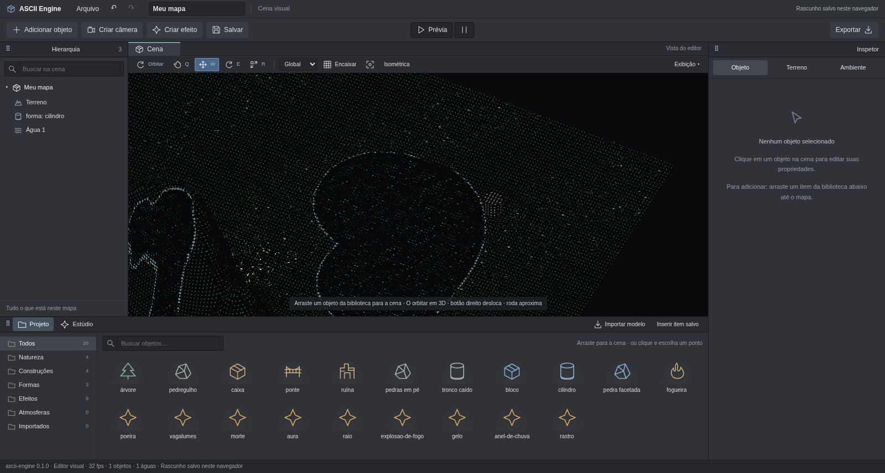

# Câmera em 3D, prévia e água — 11/10/2026

Capturas reais em Chromium com GPU e no Orca Browser; nenhuma imagem gerada.
A cópia da cena do dono foi usada apenas em perfil isolado para reproduzir
as duas imagens relatadas. Não foi substituído o documento da aba do dono.

## Câmera

- [Miniatura ao mover pelo gizmo](camera-miniatura.png).
- [Câmera selecionada e lago, por cdpshot](camera-cdpshot.png).
- `verify-composition.log`: arrastos nativos, órbita horizontal/vertical,
  miniatura ao vivo, prévia pela câmera inicial, histórico, efeitos e player.
- O teste também suspende `requestAnimationFrame` e verifica que a página
  visível continua animando e atualiza a câmera pelo caminho alternativo.
- [Orca Browser](orca-agua.png): a mesma aba antes não recebia rAF, apesar
  de `document.hidden === false`. Após a correção, tempo avançando e 20 fps.

## Água

| Antes | Depois |
| --- | --- |
|  |  |

- [Cilindro refletido de lado](cilindro-reflexo-lateral.png),
  [reflexo desligado](cilindro-sem-reflexo.png),
  [vista pela margem oposta](cilindro-vista-oposta.png).
- [Luar alinhado à câmera](luar-alinhado.png) e
  [luz rotacionada](luar-rotacionado.png).
- [Antes do impacto](agua-antes-impacto.png) e
  [rastro de um objeto movido na água](agua-rastro-do-objeto.png).
- [Encosta inicial](encosta-inicio.png), [escoando](encosta-escoando.png)
  e [controles do inspetor](inspetor-agua.png).
- [Canais da catedral](catedral-agua.png): contorno GLSL e domínio de
  simulação em CPU coincidem, preservando a área de água existente.

`verify-water.log` verifica pixels do canvas (diferença maior que 8/255),
reflexo conforme a vista, brilho conforme a luz, deslocamento da superfície
por objetos, corrente descendo, vértices molhados acima do chão e receita
inalterada pela simulação. O teste do núcleo verifica conservação de
volume, estabilidade em desnível, nascente e propagação sem cruzar margens.

## Verificação e limites

`pnpm check`: 77 testes, tipos e build passaram. Os logs de `verify:water`,
`verify:composition`, `verify:visual`, `verify:authoring` e `verify:api`
estão nesta pasta. `cdpshot.log` registra 60 fps na captura com miniatura.
Avisos existentes de bundle grande e comentários PURE do Zod permanecem.
`compare.log`: cinco vistas passaram; floresta excedeu o limite com
RMSE 0,0595. `compare-forest.log`: repetição isolada passou com 0,0095,
sem alteração de código ou baseline. A cena tem oscilação já registrada
por integrar o percurso do personagem conforme o tempo entre quadros.

É água rasa sobre uma grade, limitada à máscara pintada. A queda segue o
relevo; não há fluido volumétrico, expansão fora da pintura, respingos
balísticos, cortina livre nem flutuação de corpos rígidos. O brilho é da
luz principal; não foi acrescentado um disco de lua ao céu. Espelho de
objetos nas partes calmas; partículas separadas não entram no reflexo.
Tauri nativo não foi executado. Câmeras continuam ortográficas.
