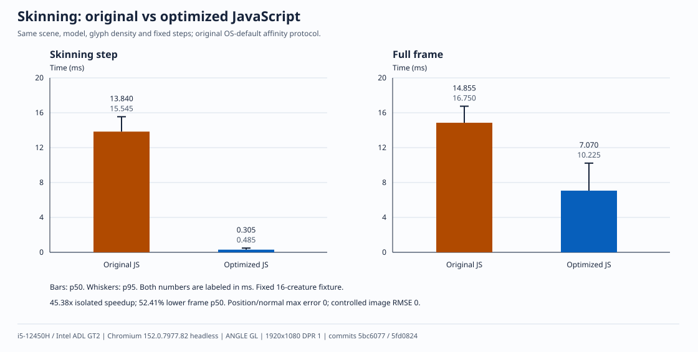
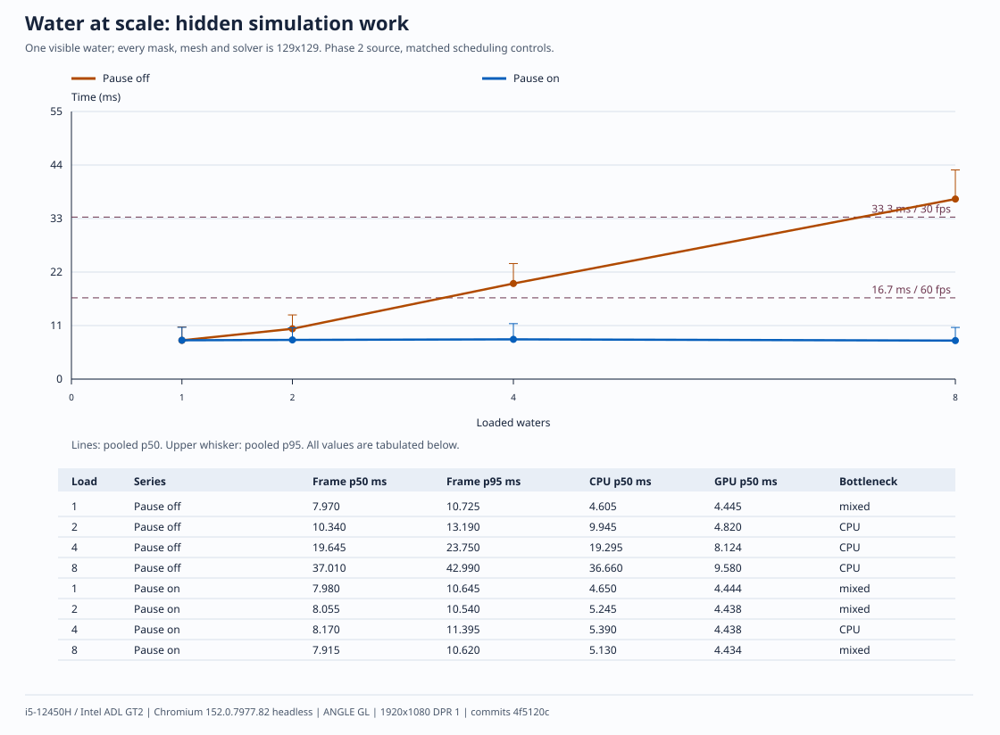
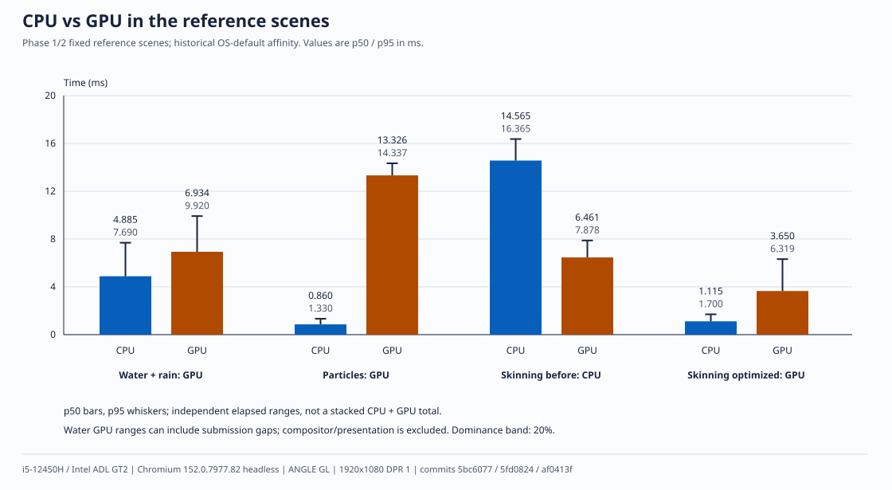
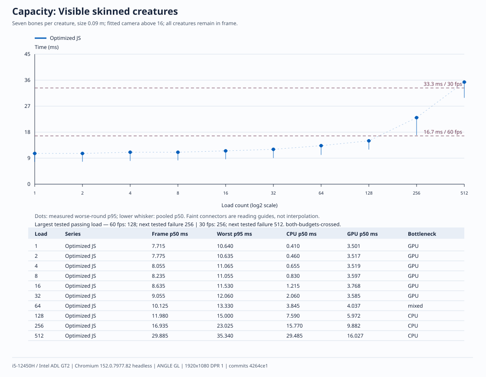
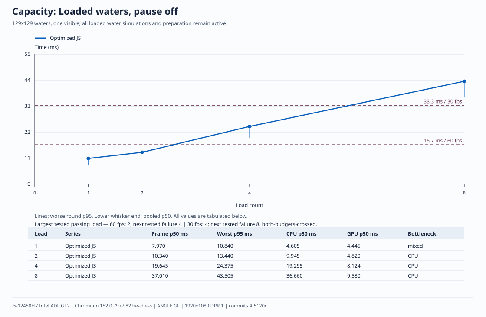
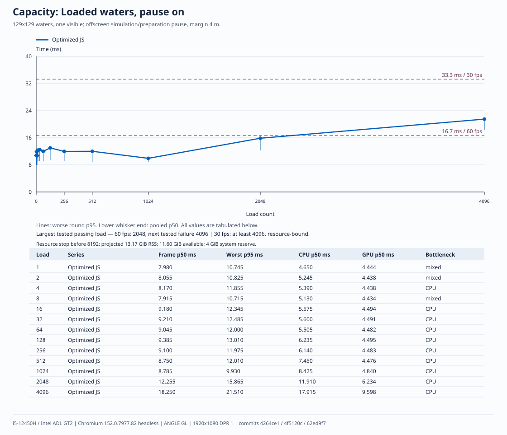
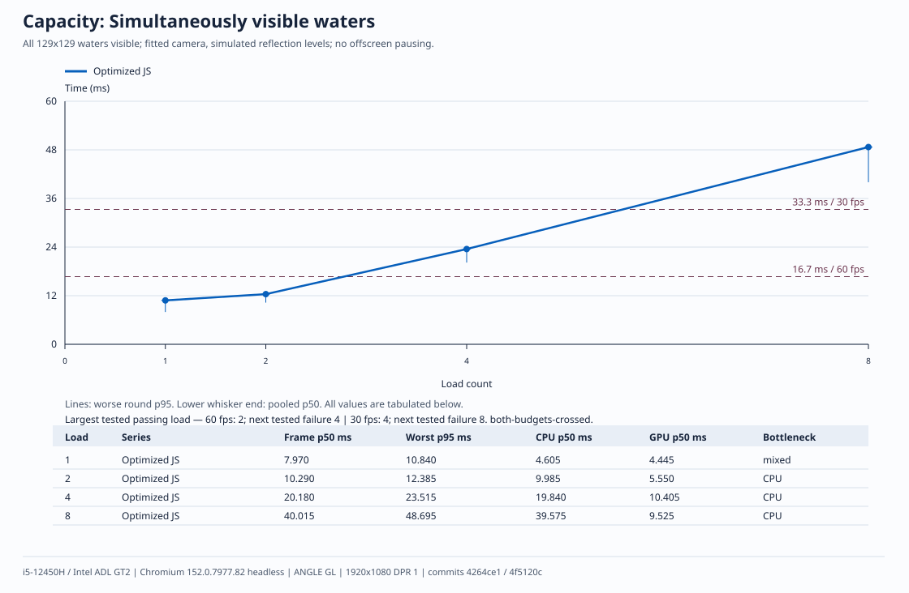
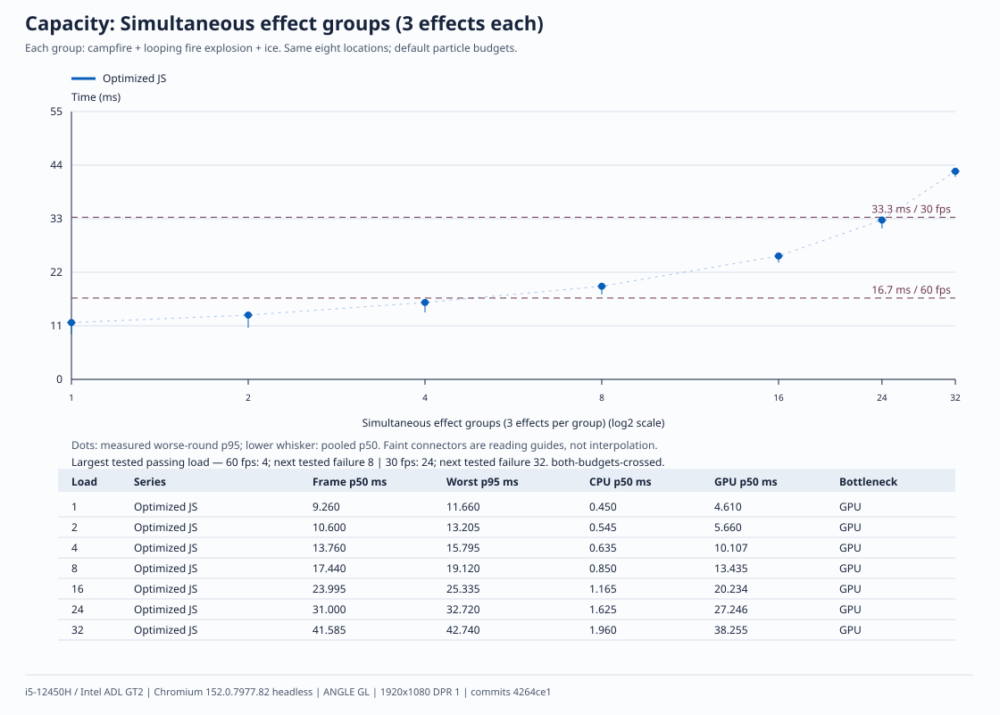
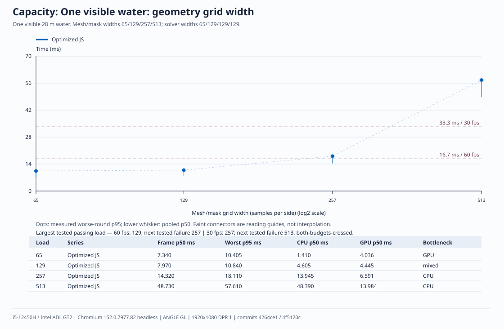

# Performance without WebAssembly

Skinning is **45× faster in JavaScript** after eliminating repeated vertex work.
Offscreen-water cost is addressed by pausing hidden simulation and preparation.
Visible water is the next CPU limit: the original run sustained **two simultaneous waters at 60 fps**, and the optimized follow-up stops at a numeric-target review gate.

How much can this engine render at 60 fps using JavaScript on this machine?
The study found that the reference skinning bottleneck could be removed in JS,
and that hidden-water work should be skipped before considering another language.
GPU-heavy rain/water and particles do not become faster simply by moving CPU
code to WASM. [ADR 0004](decisions/0004-webassembly-for-simulation.md) retains
the original decision rule; its visible-water simulation question is now
reopened for owner review, with no WASM implementation.

## Method

Intel Core i5-12450H, Mesa Intel ADL GT2, Chromium 152.0.7977.82 headless,
ANGLE GL, 1920×1080, DPR 1. Seeded
URL fixtures use fixed dt 1/60 s, with vsync and frame-rate limiting disabled.
Each point has two rounds of five fresh Chromium processes: 600 warm-up and
600 measured frames per execution. Extensions are disabled and the active
renderer main thread uses P-core CPU 6; GPU/other threads and machine power
settings are unchanged. Full-frame p50 must repeat within 5%. The historical
skinning before/after comparison uses its original OS-default affinity on both
sides; its bars are not mixed into the controlled capacity measurements.

Capacity uses the **worse round frame p95**, with budgets of 16.7 ms and
33.3 ms. “Maximum” means the highest tested passing load, with the next failing
point shown; no integer capacity is interpolated between samples. CPU and GPU
elapsed ranges overlap. Their 20% separation is a descriptive bottleneck label,
not a claim that every remaining millisecond belongs to one processor.

The runner bounds outstanding GPU work to two frames with asynchronous fences.
It measures actual free-running frame intervals, not 60 Hz rAF timestamps or
just submission time. Water GPU ranges can include CPU feeding gaps between
reflection passes; they are not exclusive GPU busy time. Frame time also
includes dispatch/polling. These are headless throughput measurements, not
physical display scanout or a promise of equal performance in another browser.

## Capacity

| Axis                                             | Maximum measured at 60 fps · p95 ≤16.7 ms | Maximum measured at 30 fps · p95 ≤33.3 ms |
| ------------------------------------------------ | ----------------------------------------: | ----------------------------------------: |
| Visible skinned creatures                        |                           128 · 15.000 ms |                           256 · 23.025 ms |
| Loaded waters, pause off                         |                             2 · 13.440 ms |                             4 · 24.375 ms |
| Loaded waters, pause on (one visible)            |                         2,048 · 15.865 ms |                        ≥4,096 · 21.510 ms |
| Simultaneously visible waters, optimized normals |                            ≥2 · 14.160 ms |                            ≥2 · 14.160 ms |
| Effect groups (three effects each)               |         4 groups = 12 effects · 15.795 ms |        24 groups = 72 effects · 32.720 ms |
| Water mesh/mask width                            |                       129×129 · 10.840 ms |                       257×257 · 18.110 ms |

Visible water uses the October 16 follow-up: collection stopped at two waters
because remaining numeric CPU work qualifies for owner review. Both entries
are tested **lower bounds**, not newly measured maxima; four/eight optimized
waters were not timed. The fresh before control sustained two/four waters at
60/30 fps (worst-round p95 12.530/27.260 ms).

All other rows retain the October 15 implementation and data. In particular,
loaded-water and mesh-grid axes have not been remeasured after the normal
optimization; they are historical bounds, not updated ceilings for that code.
The paused-water 30 fps entry is also a **lower bound**, not an observed FPS ceiling.
The next 8,192-water load was not allocated: projected renderer peak RSS was
13.173 GiB versus 11.595 GiB currently available, before the required 4 GiB
system reserve. Peak VmHWM includes state-fingerprint allocations outside timed
frames. Physics width remains capped at 129 even for larger mesh/mask grids.

Each axis is measured independently. Combining the maxima in one scene has not
been tested. See the [complete point tables](captures/benchmarks-2026-10-15/capacity/results.md)
for frame, CPU and GPU p50/p95, round repeatability, actual letter counts,
configuration, raw data links and the bounds of each historical workload. The
[visible-water follow-up](captures/benchmarks-2026-10-16/visible-water/results.md)
contains the new matched before/after values and raw rounds.

## Skinning: optimize the repeated work

The fixed 16-creature scene originally repeated skinning for three corners of
every letter: 54,537 generic vertex calls for 2,302 distinct source vertices.
Caching skinned source vertices and bone products reduces the isolated p50
from 13.840 to 0.305 ms (**45.38×**), and full-frame p50 from 14.855 to
7.070 ms (**52.41% lower**). Positions/normals have maximum error 0 and
controlled images have RMSE 0. The optimized reference scene is GPU-dominant;
no WASM or GPU-skinning implementation was needed.

## Water: loaded is different from visible

With one water visible, eight loaded 129×129 waters take frame p50/p95
37.010/42.990 ms (pooled percentiles) when all are updated, versus
7.915/10.620 ms when hidden waters pause. This removes unnecessary CPU simulation and geometry/texture
preparation; it does not accelerate visible water or reduce its pixel cost.
The rain-water reference is GPU-dominant, while the sloping single-water
scale fixture is mixed. Many visible waters and their reflection-level work
can become CPU-dominant: the bottleneck depends on the scene.

The editor and exported player pause hidden waters by default, with a 4 m
frustum margin. Returning water resumes with the current dt and never catches
up elapsed hidden time. Shader/ring clocks and explicit rain/disturb calls
continue. Results remain deterministic for the same initial state, seed,
fixed steps, external inputs **and camera path, including projection/viewport**;
they differ from full simulation after different camera histories. Offline/parity views simulate all
loaded waters. The Display control or `?water-policy=off` selects full live
simulation; see the [editor guide](guia-editor-visual.md#water-flow-reflections-and-interaction).

## Visible water: optimize normal reconstruction, then stop for review

At two visible waters the before control used **5.023 ms active CPU per water**.
Preparation was the largest section; CPU sampling located repeated generic
attribute/vector calls in Three's indexed normal reconstruction. The JS change
uses direct float32 arrays, preserving the original accumulation and rounding
order. Nonstandard attributes and custom methods retain the Three path.
Simulation, deformation, texture inputs, bounds and reflection passes are unchanged.

| CPU p50 per water, ms              | Before | Optimized JS |
| ---------------------------------- | -----: | -----------: |
| Numeric simulation                 |  1.385 |        1.587 |
| Geometry/texture preparation       |  3.072 |        1.810 |
| Mirror setup/reflection submission |  0.352 |        0.450 |
| Remaining scene/render work        |  0.175 |        0.280 |
| Active CPU per water               |  5.023 |        4.170 |

Sections are independent medians; remainder is calculated per frame before
percentiles. Actual GPU uploads happen during render submission. Preparation
p50 falls **41.09%**, active CPU p50 **16.97%**. The full frame result is smaller:

| Visible waters | Before frame p50 / p95 ms | After frame p50 / p95 ms | After CPU / GPU p50 ms |
| -------------: | ------------------------: | -----------------------: | ---------------------: |
|              1 |            7.835 / 10.375 |           8.345 / 10.935 |    3.310 / 4.490 · GPU |
|              2 |           10.420 / 12.430 |           9.580 / 13.710 |    8.340 / 4.312 · CPU |

At two waters frame p50 improves **8.06%**, but p95 worsens **10.30%**; at one,
the frame is slower despite lower CPU cost. This is not a general frame or tail
improvement claim. Four complete failed points (round differences 5.06%,
10.76%, 6.30%, 8.34%) remain as scheduling diagnostics. Passive sampling shows
variable activity on CPU 6's SMT sibling and renderer scheduling delays; it
does not establish a single cause for every spike. The first complete passing
point at each load is retained: round differences **4.47% / 1.30%** at one/two
waters. No runs within a point were filtered or combined with another attempt.

The remaining water step is **3.175 ms / 9.580 ms = 33.14% of frame p50**,
with CPU dominance in the aggregate and both rounds. This meets the original
numeric-CPU qualification rule after JS optimization. Following the owner's
instruction, collection stops here: no higher-load timing, further optimization
or WASM prototype. Qualification does not establish 2× isolated acceleration,
≥15% frame improvement, p95 stability or fallback for an alternative.

Fourteen water cases compare 11,073,154 values with **maximum error 0** and
identical images; seven existing area/GLTF images also have RMSE 0. See the
[follow-up protocol, profiles, diagnostics and validation](captures/benchmarks-2026-10-16/visible-water/README.md)
and [all p50/p95 values](captures/benchmarks-2026-10-16/visible-water/results.md).

## CPU and GPU bottlenecks

Particles in the reference scene are GPU-dominant. Reducing JavaScript work
cannot count as a frame gain while the GPU remains the longer side of the
pipeline. The water step's original 20.9% share of active CPU was therefore
not evidence for WASM: it was only 9.23% of the uncapped reference frame.
Any future candidate still needs numeric CPU work occupying at least 15% of
the frame, then a measured 2× isolated improvement and ≥15% full-frame p50
improvement against optimized JS, without p95 regression, with parity and a
JS fallback.

## Capacity curves

Capacity dots show the worse round p95; the lower whisker end is pooled p50.
Load axes use log2 spacing; faint connectors guide reading, without interpolating
untested loads. The tables
inside each SVG label every load and its frame/CPU/GPU values in milliseconds.
Non-monotonic intervals are retained: dispatch/queue timing and scheduling can
affect headless intervals. Do not interpolate an exact capacity between loads.

## Limits and reproduction

- Creatures use a fixed seven-bone, 144-vertex fixture with about 1,100 letters
  each at a 0.09 m base glyph size. The static floor is 34 m wide. The camera
  fits larger crowds, so projected creature size is not constant. Counts are
  not limits for arbitrary imported models.
- Loaded waters are 28 m wide and 64 m apart, with one visible. All-visible
  waters use a fitted camera and may require independent reflection levels.
  The static floor is 1,024 m wide; far hidden pools have their own local bed.
  This isolates water scheduling/resources, not full-world terrain complexity.
  Growth beyond 512 uses measured peak RSS and preserves 4 GiB of available
  system RAM. A resource bound is not an observed FPS ceiling.
- Effect groups contain three simultaneous effects and repeat eight positions,
  increasing overdraw. Default live-letter/draw-buffer budgets remain in force;
  saturation would be recorded as a resource bound. The untimed audit observed
  all 1,201 steps of each case, with no clipping (maxima: 5,028 live letters and
  7,658 drawn points).
- Water mesh/mask widths are 65/129/257/513, but the existing physics solver
  caps width at 129. The larger points measure geometry/preparation costs,
  not 257×257 or 513×513 simulation.
- These values apply to this **i5-12450H / Chromium headless / ANGLE GL**
  profile. Mobile devices, other GPUs, WebKitGTK and Linux/Tauri are unmeasured.
  A weaker platform or a workload beyond the measured budgets is a reason to
  profile again, not proof that WASM will help.

Run `pnpm dev`, then `pnpm bench:capacity --out=.cache/capacity-new-study`
with a fresh output path to collect new measurements. The collector resumes
complete points when reusing an existing output. Raw samples, environment and source
revisions are retained in the [capacity manifest](captures/benchmarks-2026-10-15/capacity/manifest.json).
`pnpm bench:charts` regenerates the SVGs and derived tables from those JSONs,
using only Node’s standard library; two runs produce identical bytes. The retained
42 axis points reference 40 distinct two-round case cohorts; the identical
one-water control is reused across three axes. All accepted frame-p50 round
differences are within 5% (maximum 4.50%); complete failed points remain available
as scheduling diagnostics. See [Phase 1](captures/benchmarks-2026-10-15/README.md),
[Phase 2](captures/benchmarks-2026-10-15/phase-2/README.md) and
[capacity protocol/results](captures/benchmarks-2026-10-15/capacity/README.md).
The original [study plan](wasm-performance-study-plan.md) remains unchanged.
