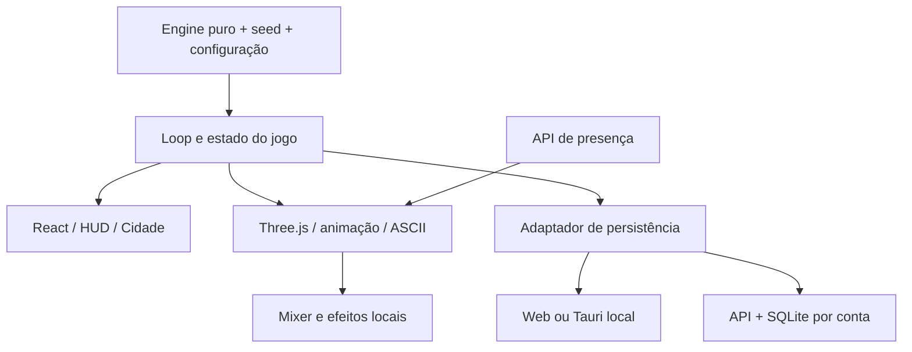

# Pomorog — manual de produção e manutenção

Estado documentado em **10/10/2026**. Complementa o [guia visual](style-guide.md)
e a [retomada](continue.md). Descreve a implementação atual, os cuidados que
resultaram das revisões e um processo para continuar sem perder a identidade.

Conteúdo: [arquitetura](#arquitetura), [renderização](#renderização),
[modelos e assets](#modelos-e-assets), [animação e clima](#animação-e-clima),
[áudio](#áudio), [gameplay](#evoluir-gameplay-e-balanceamento),
[produção](#processo-de-uma-mudança), [validação](#validação),
[vídeos](#capturas-e-vídeos), [release](#entrega-e-versões).

## Arquitetura

| Responsabilidade | Arquivos/pastas | Fronteira |
| --- | --- | --- |
| Regras, RNG, combate, loot, atributos, progressão | `src/engine/` | TypeScript puro, determinístico; sem React, DOM, Three, rede ou Tauri |
| Loop, relógio, ações, save | `src/game/` | Orquestra engine e persistência; tempo real por timestamps |
| Cena e HUD principal | `src/ui/visual/` | Consome estado/eventos; não concede XP nem decide resultado do combate |
| Telas, modais e terminal legado | `src/ui/screens/`, `src/ui/modals/`, `src/ui/tui/` | Reutilizam ações do jogo |
| Áudio | `src/ui/audio/` | Eventos de apresentação, mixer e preferências locais |
| Contas, sala, presença, transporte | `src/online/` | Integra UI/API; não torna a simulação autoritativa |
| HTTP e banco | `server/` | Node 24, SQLite, autenticação, saves e salas |
| Plataforma | `src/platform/`, `src-tauri/` | APIs nativas só via adaptadores, com alternativa web |
| Textos | `src/i18n/pt.ts`, `src/i18n/en.ts` | Identificadores estáveis, tradução dos fluxos normais |
| Distribuição | `Dockerfile`, `compose.yaml`, `deploy/`, `.github/workflows/` | Web/API em Docker; desktop por sistema operacional |



A demo monta um fluxo separado em memória; não monta o store normal.
`demo.ts` usa o resolvedor de combate, mas força atributos de prévia e escolhe
drops/tempos para apresentação. O terminal clássico continua disponível, porém
a apresentação principal é `GameScreen.tsx`.

### Relógio e persistência

Não vincular progresso ao FPS, ao número de passos ou ao tempo de uma animação.
O relógio visual pausa com a apresentação/visibilidade; a Hunt real segue as
regras da máquina de estados e timestamps. Ocultar a página não equivale a
apertar Pausar na Hunt. Preserve as regras existentes ao mexer nesses caminhos.

O save está no schema **2** em `src/game/save.ts`, com migração v1 → v2,
validação e recusa de versões futuras. Guarda seed, configuração e histórico
das Hunts. Novos campos persistidos precisam de defaults/migração, validação
local e no servidor, teste com save anterior e recuperação em caso de falha.
Não limpar save para fazer uma versão nova iniciar.

No modo web local, o adaptador atual usa `localStorage`; no Tauri, arquivo via
adaptador nativo; com conta, armazenamento remoto por API. Menções a IndexedDB
no ADR original descrevem a proposta antiga, não a implementação web atual.

`save-writer.ts` serializa gravações; o online tem revisão e repetição idempotente.
Preserve conflito entre dispositivos, último estado confirmado, backup do estado
em memória e comportamento quando a API cai. Contas não compartilham progresso.

## Renderização

Referência técnica completa: [pipeline visual](visual-pipeline.md) e
[documentação da engine](engine/README.md) (animação, UI/UX, sprites, áudio,
recriar do zero). O resumo abaixo descreve a ordem geral.

Ponto de entrada: [scene.ts](../src/ui/visual/scene.ts), criado por
[AsciiWorld.tsx](../src/ui/visual/AsciiWorld.tsx).

1. Instancia ambiente, atores articulados, câmera ortográfica, luzes e efeitos.
2. Atualiza movimento por `dt`, eventos, posição dos pés, clima e descoberta.
3. Quando necessário, renderiza reflexo da geometria para a água.
4. Renderiza cena em `WebGLRenderTarget` com cor e `DepthTexture`.
5. `createAsciiPass()` amostra cor/profundidade/material; materiais que já são
   letras (ID `.85`: superfícies, corpos, água) passam direto; os demais viram glifos na grade de tela.
6. Camadas de capim, água, chuva, efeitos e neve compartilham profundidade.
7. Labels de nome/HP/dano são projetados em elementos sobre o canvas.

O filtro trabalha na GPU. Não introduzir leitura de todos os pixels pela CPU
a cada frame. `toDataURL` pertence à captura/bake, não ao loop normal.

### Material é parte da linguagem

[surface.ts](../src/ui/visual/surface.ts) escreve um identificador no alfa do
render intermediário. **Esse alfa seleciona material; não é opacidade.**

| Superfície | Alfa |
| --- | --- |
| Reflexo legível | 0,0 |
| Neve | 0,1 |
| Casca | 0,2 |
| Grama molhada | 0,3 |
| Madeira | 0,4 |
| Ator | 0,5 |
| Pedra | 0,6 |
| Folhagem | 0,7 |
| Água | 0,8 |
| Terra | 0,9 |

O alfa zero do reflexo é um ID de material opaco, não transparência.
`waterReflection.ts` usa um render de 640 × 640 com câmera espelhada e plano de
corte no nível da água; restaura render target, clipping e sombras ao terminar.
`channelWater.ts` limita o espelho ao rio/alas laterais, e o pântano conserva a
máscara compartilhada de inundação. O shader mistura cor e distorce UV antes da
conversão ASCII; a silhueta refletida usa um alfabeto separado dos traços da água.
`shoreDetails.ts` cria capim instanciado, pedra/musgo e vento na cena principal;
essas margens entram no reflexo. Partículas e camadas posteriores não entram.

Use `tagSurface()` em materiais novos; atores também passam por
`markActorInk()` em `actorInk.ts`. Alfa inesperado pode escolher o alfabeto errado,
mesmo quando a geometria e a cor parecem corretas no render bruto.

`ascii.ts` usa cinco amostras de cor, grade estável, alfabetos específicos,
contornos por profundidade, tratamento de luz e base discreta entre os glifos.
O renderer usa `LinearSRGBColorSpace`; o shader faz o tratamento de cor existente.
Não acrescentar conversão gamma duplicada ao tentar corrigir um vídeo.

### Iluminação e oclusão

`illumination.ts`/`exploration.ts` controlam lanterna, memória e obstáculos.
`old_mine` e `sunken_cathedral` usam descoberta; exteriores usam luar.
`environment.ts` fornece ambiente, acampamento e obstáculos.

As rochas irregulares da mina já sumiram porque caixas retangulares de oclusão
cobriam suas próprias faces. Elas recebem sombra da geometria; não reintroduzir
caixas como paredes no campo de descoberta sem verificar o resultado.
Escoras/alvenaria continuam podendo bloquear visão.

### Desempenho e ciclo de vida

Renderização por `requestAnimationFrame`, DPR máximo 1,5, aba oculta sem desenhar,
recursos/listeners liberados no descarte. Não há limite atual fixo de 30 fps;
essa afirmação em registros antigos pertence à POC inicial.

Use instâncias e limites de memória para partículas. Verifique troca de região,
retorno ao terminal, remount, resize e perda de contexto WebGL. FPS observado
localmente não é garantia de desempenho em outras GPUs/webviews.

## Modelos e assets

### Onde construir

- Herói e famílias de criaturas: `models.ts`; criaturas do pântano em
  `wetlandCreatures.ts`.
- Objetos de inventário: `itemModels.ts`.
- Ambientes: `environment.ts`, `swampEnvironment.ts`, `snowEnvironment.ts`;
  árvores do pântano em `wetlandTrees.ts`.
- Retratos: `snapshotAssets.ts`, `itemSprites.ts`, `AsciiItem.tsx`,
  `CreaturePortrait.tsx`, `TravellerPortrait.tsx`.

Comece pela silhueta e escala em relação ao herói. Divida peças que precisam
articular, escolha materiais e tags, examine sob o filtro e só então refine
detalhes. Detalhe menor que a célula pode sumir; mais polígonos não garantem
melhor leitura em ASCII. Preserve IDs de item/monstro usados por saves.

Blender está disponível conforme o usuário, mas não é dependência do pipeline.
Se uma tarefa futura justificar usá-lo, registre fonte editável, exportação,
escala/eixos e integração. O asset final precisa obedecer ao mesmo filtro,
silhueta e animação; não introduzir um segundo estilo de ilustração.

### Fotografar os sprites

A galeria [render-assets.html](../scripts/render-assets.html) usa as geometrias
reais e `createAsciiPass()`. `snapshotAssets.ts` enquadra bounds em câmera
ortográfica, ilumina para retrato e produz PNG. A luz de fotografia usa brilho
1,35; não transferir esse valor para o padrão de luz do mundo (1,0).
Itens/criaturas: 256 × 240; herói: 180 × 220.

Com o dev server e Orca disponíveis:

```bash
pnpm assets:bake
pnpm assets:check
```

Se o servidor estiver em outra porta, passe a URL explicitamente:

```bash
python3 scripts/bake-sprites.py --url http://localhost:1422/scripts/render-assets.html
```

O script usa **`orca-ide`**, salva os PNGs e `public/sprites/manifest.json`
com SHA256. Reutilização de uma aba é possível por `--page`. Descubra o ID na
sessão atual; não copie IDs temporários de uma conversa antiga. Instalar e jogar
não exige bake; os PNGs prontos estão no projeto.

`assets:check` verifica cobertura dos IDs, assinatura PNG e dimensões mínimas.
Não avalia qualidade da arte nem compara o SHA256 do manifesto. Olhe a galeria
e a miniatura nos painéis após gerar; sincronize PNGs/manifesto com a geometria.

## Animação e clima

`motion.ts` contém amortecimento por tempo, giro pelo menor ângulo, passada e
fases de ataque/reação. `scene.ts` liga eventos ao modelo; passos usam distância
e pontos reais das botas. A preparação/impacto está baseada em atraso de 0,2 s,
com mais 0,22 s para viagem do fogo (`feedbackImpactDelay`). Se ajustar timing,
revise também efeitos, dano visual e áudio.

| Sistema | Arquivos | Cuidados |
| --- | --- | --- |
| Caminhada/contato | `motion.ts`, `models.ts`, `footWater.ts` | Pé apoiado, altura, água vs passarela, pausa e 30/120 fps |
| Chuva | `rain.ts`, `rainStreaks.ts` | Traços finos, direção projetada, oclusão e impacto estável |
| Margem e nível | `swamp.ts`, `swampHydrology.ts` | Água rasa gradual; efeitos e submersão usam a mesma superfície |
| Ondas/reflexos | `rippleField.ts`, `swampWater.ts`, `waterReflection.ts` | Propagação/amortecimento por tempo; ondas discretas |
| Tempestade | `storm.ts` | Intervalos irregulares, clarão limitado, som atrasado |
| Neve | `snow.ts`, `snowEnvironment.ts` | Mesma fronteira de neve para chão, botas, calor e flocos |
| Efeitos/vegetação | `effects.ts`, `glyphCloud.ts`, `grass.ts`, `water.ts` | Coordenadas 3D, profundidade e brilho coerentes |

Neve atual: acúmulo `.28 + .72 * (1 - exp(-t / 42))`; raio de derretimento
aproxima-se de 1,83 a partir de 1,48 com constante de 38 s; até 256 pegadas,
vida de 110 s, textura 512² em extensão de 32 unidades; campo de 950 flocos.
São limites visuais da implementação, não valores de combate ou clima persistido.

### Acrescentar uma área

1. Registrar ID/bioma em `src/engine/content/locations.ts` e tipos necessários.
   Definir separadamente encontros, requisitos, recompensas e intenção visual.
2. Atualizar PT/EN e seleção. Não usar nome traduzido como identificador.
3. Integrar ambiente, caminho visual, acampamento, luz, oclusão, clima e som.
4. Reutilizar materiais/técnicas atuais. Verificar rota, combate e retorno ao fogo.
5. Conferir save e presença online: servidor usa `LOCATION_IDS`, mas inclusão
   no catálogo não substitui o teste de render e de validação.
6. Se fizer sentido para a apresentação, incluir em `DEMO_AREAS` e verificar
   transições/duração. Demo não define a economia da área real.
7. Salvar prints, validar e atualizar o índice de referências.

Não transformar chuva/neve em penalidade, dano ou loot por iniciativa de uma
tarefa puramente visual. Atualmente pântano e neve compartilham o perfil da
floresta por escolha explícita de escopo.

## Áudio

`Audio.tsx` integra UI; `mixer.ts` faz mixagem/ambiente; `timeline.ts` sincroniza
eventos; `synthesis.ts` gera texturas; `settings.ts` guarda preferências.
Padrões: geral 0,65, efeitos 0,8, ambiente 0,65. Requer gesto inicial do usuário.

Assets/atribuição em [public/audio/README.md](../public/audio/README.md),
[sources.json](../public/audio/sources.json) e licenças ao lado dos arquivos.
Foley de Kenney, lâminas de artisticdude/StarNinjas, chuva de Ylmir e água de
rubberduck estão documentados como CC0. Vento, trovão e outras texturas têm
geração local. Nenhum serviço externo de áudio é necessário para tocar.

Chuva usa duas gravações em loop estéreo de 26 s, mistura 72%/28%, graves/agudos
controlados. Passos d'água receberam corte de graves e alvo mais baixo (-28 LUFS,
-10 dBTP). Espada tem três swishes e três contatos com caudas curtas. Receitas
exatas e fontes estão no README do áudio; não regenerar como ruído branco.

Escute caminhada, luta, fogo, chuva e tempestade juntos; veja clipping, repetição,
balanço e interrupção/retomada. Se não houver avaliação auditiva, informe isso:
metadados e níveis de sinal não provam qualidade percebida do som.

## Evoluir gameplay e balanceamento

### Decisões que permanecem

Hunt é automática. Bonfire é pausa interna, Cidade encerra/resume resultados.
Preparação, estratégia, equipamento, destino e habilidades são espaços para
decisão; não exigir inputs durante foco. Preserve risco e progressão existente
até haver uma mudança concreta pedida/definida.

| Mudança | Começar por |
| --- | --- |
| HP, dano, acerto, crítico e atributos derivados | `src/engine/stats.ts`, `combat.ts` |
| Classes/skills/gatilhos | `src/engine/content/classes.ts`, `skills.ts`, `combat.ts` |
| Monstros e drops | `src/engine/content/monsters.ts`, `items.ts` |
| Destinos, composição e desbloqueio | `src/engine/content/locations.ts` |
| Densidade de eventos e recompensas | `src/engine/hunt.ts`, `simulate.ts`, `run.ts` |
| Timer e transições do loop | `src/game/machine.ts`, `store.ts` |
| Persistência | `src/game/save.ts`, `validate-save.ts`, `save-writer.ts`, servidor |

Mudar um modelo visual não deve mudar atributos. Mudar uma regra não deve
trocar câmera, paleta ou shader incidentalmente. Use o menor conjunto de arquivos
necessário e mantenha as fontes de conteúdo como autoridade dos IDs/valores.

### Processo numérico

```bash
pnpm sim
```

[scripts/simulate.ts](../scripts/simulate.ts) executa **2.000 Hunts por linha**,
com seeds `sim-0` a `sim-1999`. O relatório atual cobre principalmente a floresta:
estratégias iniciais, durações, builds de classe, drops e economia de equipamento.
Não pressupor que o comando cobre automaticamente as cinco regiões.

Antes/depois devem usar as mesmas seeds, builds e configurações. Compare:

- Mortes; XP p10/p50/p90; HP restante p10/p50; gold/loot p50.
- Renda por Hunt e por tempo de foco; custo em Hunts para o próximo equipamento.
- Frequência de drops; experiência do jogador azarado, além da média.
- Estratégias e classes; duração de bloco e estágios de progressão.

Amplie o cenário da simulação se a mudança for numa região/build não coberta.
Não ajustar expectativas de teste apenas para fazer um resultado novo passar.
Documente hipótese, configuração, distribuição antes/depois, resultado e limite.
Os números de apresentação em `demo.ts` não servem como medida de dificuldade.

Um pedido de rebalancear já autoriza investigar, simular e implementar o ajuste
no escopo pedido. Não criar portões artificiais de aprovação. Decisões de escopo
que dependem do usuário continuam precisando de esclarecimento real.

## Processo de uma mudança

1. Ler retomada, guia e referência da área. Conferir `git status` e trabalho
   acumulado; não confundir arquivo não rastreado com arquivo descartável.
2. Escrever em poucas linhas problema, resultado esperado e limite da mudança.
   Para correção pontual, isso pode ficar na descrição/registro da entrega.
3. Reproduzir e registrar o antes: estado, viewport, mapa, seed/timer quando
   pertinente. Não ajustar vários sistemas globais sem comparação intermediária.
4. Implementar preservando fronteiras. Novos sistemas grandes merecem documento
   de comportamento; refinamentos autorizados não precisam reiniciar o projeto.
5. Rodar verificações pertinentes e observar o jogo no Orca quando houver efeito
   visual/de interação. Testes determinísticos e inspeção se complementam.
6. Registrar depois, atualizar guias se um contrato mudou e informar limites.
   Uma nova aprovação visual do usuário atualiza a referência principal.

Regras operacionais em [AGENTS.md](../AGENTS.md). Skills de design não devem
reorientar o estilo aprovado. Documentos antigos de agosto descrevem etapas
anteriores; notas de atualização sinalizam onde a implementação evoluiu.

## Validação

| Escopo | Verificação proporcional |
| --- | --- |
| Somente docs | Links locais, comandos existentes e fatos no código; sem rebuild |
| Regra/balanceamento | Testes do motor afetado, determinismo, `pnpm sim`, save se necessário |
| Modelo/material/shader | Build, galeria se afetada, Orca em movimento, comparação antes/depois |
| Clima/pés/movimento | Testes específicos, 30/120 fps quando pertinente, pausa e contato visual |
| UI/UX | Teclado/clique, campos, modais, janela estreita, movimento reduzido e fluxos reais |
| Online/save | Testes de API/validação/gravação e fluxo com contas de teste |
| Release | `pnpm release:check`, smoke do pacote alvo e registro do que foi reconstruído |

`release:check` executa testes, fronteiras, tipagem de servidor, cobertura de
sprites, build cliente e bundle servidor. Não compila instaladores, não sobe
Docker e não faz inspeção visual automaticamente.

### Roteiro visual mínimo

- Abrir o jogo no Orca, iniciar uma Hunt de teste; ver exploração/encontro,
  HP, ataque, loot, retorno/sentar, pausa e retomada.
- Usar demo para observar rapidamente cada área, sem confundir com teste do save.
- Mundo: conferência de luz externa vs descoberta interior; alvo/rotação da
  câmera; no pântano, chuva/clarão/contato/reflexo; na neve, trilha/acúmulo/calor.
- UI: mochila, seleção/comparação, requisitos, equipar/desequipar, venda e retorno;
  janela larga/estreita e controles avançados recolhidos.
- Se afetado: entrar em conta/sala, ver amigo na mesma região, recarregar e
  verificar progresso em perfis de teste. Não manipular a conta pessoal.
- Conferir erros de console/shader, assets ausentes, áudio e descarte de recursos.

Para shader global, comparar as cinco regiões e retratos. Para ajuste numérico
sem impacto gráfico, não é preciso recriar todos os vídeos de referência.

### Orca

O usuário pediu Orca Browser. O CLI usado pelo projeto é `orca-ide`; consulte a
ajuda/skill correspondente se precisar operar abas ou screenshots. Não usar o
binário `orca` do leitor de tela Linux por engano. Descubra páginas/portas atuais.

Capturas já congelaram quando a aba embutida estava oculta. Traga a aba para
frente e confirme que recebe quadros. Algumas evidências existentes foram feitas
em Chromium headless isolado e estão identificadas como tal. Não chamá-las de
capturas do Orca, nem trocar a validação pedida silenciosamente.

## Capturas e vídeos

Guardar em `docs/ui/reference/<tema>-AAAA-MM-DD/`: imagem anterior, imagem final,
sequência quando movimento importar e README com contexto, método e verificações.
Não sobrescrever uma referência aprovada com um experimento. Marcar claramente
versões rejeitadas; atualizar [o índice](ui/reference/README.md).

Vídeos originais orientam a linguagem; são referências, não assets distribuídos
do jogo. Novas referências precisam de quadros salvos para árvores, água, fogo,
personagem, luz e movimento que introduzam algo relevante.

### Evitar a regressão de cor do MP4

Letras finas perderam crominância ao converter diretamente o canvas para YUV
4:2:0. A solução documentada foi capturar PNGs reais do framebuffer, ampliar
**2× por vizinho mais próximo antes** da conversão e declarar BT.709.

Procedimento usado nas revisões finais:

1. Capturar quadros PNG com timestamps reais e áudio do master Web Audio
   na mesma janela de tempo; não áudio sintetizado depois da gravação.
2. Validar dimensões, quantidade, intervalos entre frames e duração de áudio.
3. Montar `ffconcat` com as durações reais; `option framerate 1000` por imagem
   evita quantizar as durações no padrão 25 fps do leitor de imagens.
4. Ajustar para dimensões pares; duplicar com `neighbor`; converter matriz
   RGB → YUV BT.709/faixa limitada, sem aplicar transformação gamma extra.
5. Exportar H.264, `yuv420p`, 30 fps, AAC e `faststart`; marcar primárias,
   transferência e matriz BT.709, inclusive no bitstream H.264.
6. Conferir com `ffprobe`, decodificar integralmente com FFmpeg e reproduzir
   no Orca, comparando frames do vídeo com PNGs fonte.

Receita de filtros de referência (entrada PNG RGB):

```text
fps=30,pad=ceil(iw/2)*2:ceil(ih/2)*2,
scale=iw*2:ih*2:flags=neighbor,format=rgb24,
scale=in_range=full:out_range=tv:out_color_matrix=bt709,format=yuv420p
```

Configuração usada: libx264 CRF 14, preset slow, perfil high, GOP 30, AAC 192k.
O filtro sozinho não grava áudio/timestamps nem comprova os metadados. Veja
[diagnóstico e receita de captura](ui/reference/swamp-recording-fix-2026-10-09/README.md)
e [captura final da chuva](ui/reference/rain-visibility-2026-10-10/README.md).
IDs/portas de scripts de captura antigos precisam ser atualizados.

Prefira trechos curtos com caminhada, luta e clima quando o usuário pedir um
vídeo do jogo. Nenhum processo de exportação garante cores idênticas em todo
player; registre o que foi efetivamente comparado.

## Entrega e versões

Versão atual de pacote: **0.1.0**, alpha privada. Procedimentos de servidor,
convites, backup/restauração e instaladores em [v0.1 alpha](releases/v0.1-alpha.md).
O usuário sobe o servidor; não solicitar SSH quando basta entregar Docker.

Para uma entrega de código:

1. Verificar mudanças e atualizar notas/retomada; usar `pnpm release:check`.
2. Se entregar servidor, reconstruir/testar Docker e gerar o pacote por
   `bash scripts/package-alpha.sh`. Conferir health, persistência e arquivos.
3. Se entregar desktop, gerar os instaladores pertinentes e testar no SO alvo;
   web funcionando não prova AppImage/Windows/macOS funcionando.
4. Atualizar checksums dos artefatos entregues e registrar versão/data/origem.
5. Informar quais pacotes realmente contêm a alteração e quais não foram refeitos.

Ao incrementar versão, revisar `package.json`, `src-tauri/tauri.conf.json`,
`src-tauri/Cargo.toml`, lockfiles aplicáveis e strings/nomes de pacote/health
no servidor e scripts. Pesquise a versão antiga antes; não faça substituição
cega. Um pedido de ajuste não exige automaticamente aumentar a versão.

O pacote Docker atual inclui fontes necessárias para servir o jogo, README e
guia da alpha; **não inclui toda a pasta de referências nem este manual**.
Para continuar desenvolvimento em outra máquina, leve o repositório completo,
incluindo arquivos novos ainda não versionados. Não usar apenas o tar do servidor
como backup da documentação ou do trabalho em andamento.

Contas/salas estão implementadas, mas combate cooperativo, mercado e ranking
precisam de autoridade no servidor antes de existir economia entre jogadores.
Não apresentar presença visual como combate sincronizado. Não publicar, enviar
mensagens a amigos ou distribuir releases sem pedido correspondente.
